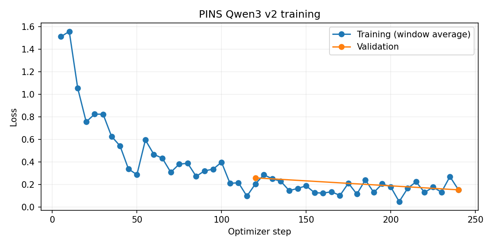

# Colab v3 preparation and measured v2 baseline

The completed Colab v2 adapter is preserved locally, not deployed or overwritten.
Run: `qwen3-pins-v2-colab-20261011-131536`, Git `a59acfb`, MCP `d9b5dc6`.
Both uploaded ZIPs contain identical shared run files; the Drive export also has
evaluation reports. Full adapter SHA256:
`38831cd0dbf5c6958f53df0930a8cabea3613b2c65810e5e4e0e1c1498ef749a`.

## Actual Colab results

Tesla T4, Python3.11.17, torch2.7.1/cu126, transformers4.57.6,
peft0.18.0, bitsandbytes0.49.1; FP16/NF4 rank8/alpha16. Completed240
optimizer steps/two epochs in3732.7 seconds (62.2 minutes).
Training window loss fell from1.510 (step5) to0.154 (step240), with fluctuations;
whole-run average0.356 is not the final window loss. Validation improved from
0.258638 at epoch1 to0.152567 at epoch2; checkpoint240 was selected.

| Saved suite | Base tool choice | Base exact arguments | v2 tool choice | v2 exact arguments |
| --- | ---: | ---: | ---: | ---: |
| 30-case sample | 14/30 | 13/30 | 30/30 | 29/30 |
| 120-case hard_gold | 60/120 | 39/120 | 100/120 | 89/120 |

These are synthetic, previously inspected suites, not independently reviewed
generalization claims. Hard-suite exact arguments are74.2%; that is insufficient
for the initial release goal. No physical MCP operations were executed by these
evaluations. V1/GGUF comparison and multilingual completion-claim review remain pending.

## New training inputs and settings

Current MCP: `e6d13f916cdf1f29a52703e5e7c893a113b2e531`. Compiled the team's
existing dispatcher with an observatory proxy that rejects all equipment calls.
All32 tool names remain; wait_seconds maximum is55, dither_every maximum32,
coordinates use anyOf number/string schemas, destructive annotations changed,
and job/resource/state checks were strengthened. Updated source-derived
catalog/audit/fixtures are checked in. Prior contracts and SFT are preserved in
ignored `artifacts/v2/contract-history/d9b5dc6...`.

`curriculum_v3.py` reads only audited train/validation and the original phrase
generator. It extends **train only** with device-name/identifier contrasts,
corrections in chat history, permission/no-permission pairs and competing tools.
All published device enum values and ten languages are covered. Existing
validation examples remain the selection set, with refreshed MCP schemas.
No test, eval_gold or hard_gold examples are augmentation seeds.
Translations and template-family diversity still need independent human review.

Verified preparation:2559 train conversations/4358 assistant turns and583
validation conversations/1236 assistant turns; all32 tools and ten languages,
zero skipped examples. Maximum lengths are1347 train/1277 validation tokens.

`config-v3.json`: context1536, FP16/NF4, rank8/alpha16, batch1,
accumulation16, seed3407, learning rate5e-5, up to3 epochs. Save/evaluate
every100 optimizer steps; early stopping patience2, improvement threshold0.002.
The best validation checkpoint is exported as the adapter. Data and settings
change together; a resulting improvement cannot be attributed to one factor.

Preparation checks every assistant turn against the real pinned Qwen tokenizer;
overlong cases fail rather than truncating or dropping examples. Full training
requires a fresh smoke using identical prepared data, contracts and curriculum.
Validation comparison supports the base, prior v2 adapter on Drive and new v3.
Gold checks are explicitly final-release measurements, not iterative tuning.

## Colab workflow

Reload the existing notebook (its filename remains `pins-ai-v2-colab.ipynb` for
compatibility), select the T4 and run from the top with a new run name. Code and
current audits are pulled from Git. Drive supplies immutable original inputs;
old Drive catalog/audit snapshots are not imported. No data ZIP re-upload is
needed. Prepared data stays on the VM; checkpoints, metrics and logs persist
in `My Drive/pins-ai/runs/qwen3-pins-v3-colab-<timestamp>`.

Training has **not** been started by this agent. T4 compatibility of the v3
recipe, runtime, resulting losses and accuracy must be measured by the new run.

## Initial prompt still open

Training specialization now has measured results. Remaining delivery work is
adapter merge/Q4_K_M export and equivalent quantized evaluation, the plugin's
complete bounded model-to-MCP-to-grounded-response loop, confirmation integration,
and Pi performance while PINS runs. The Pi was read-only inspected: its current
PINS host returns404 for `/mcp`; no live MCP endpoint is installed there yet.
No Pi deployment, PINS restart or equipment mutation occurred in this task.
An independently authored multilingual acceptance set and Pi4 measurements
remain unverified. No production model is promoted based on low loss alone.
